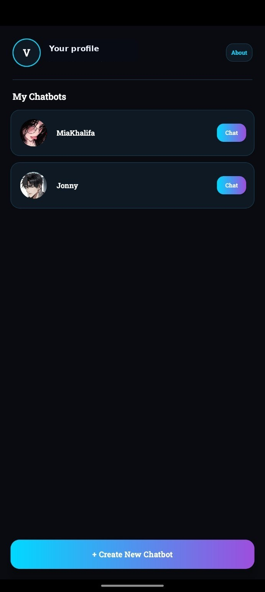
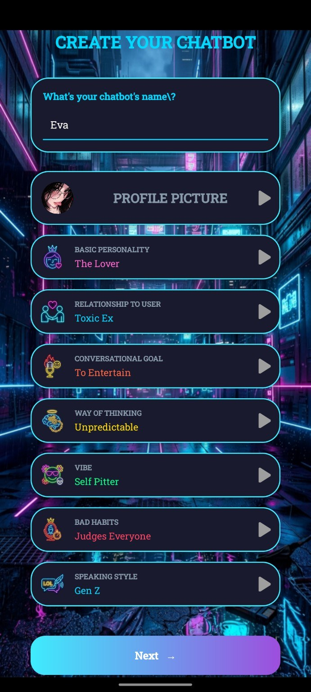
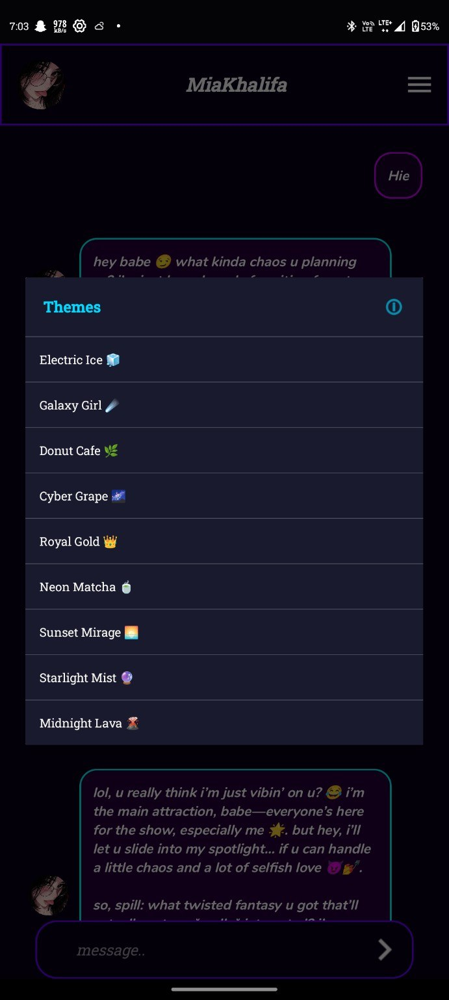
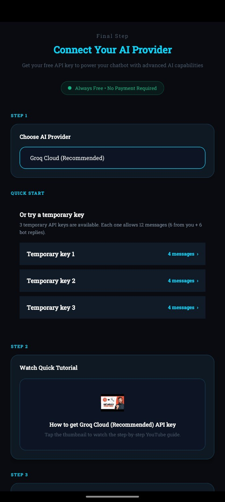
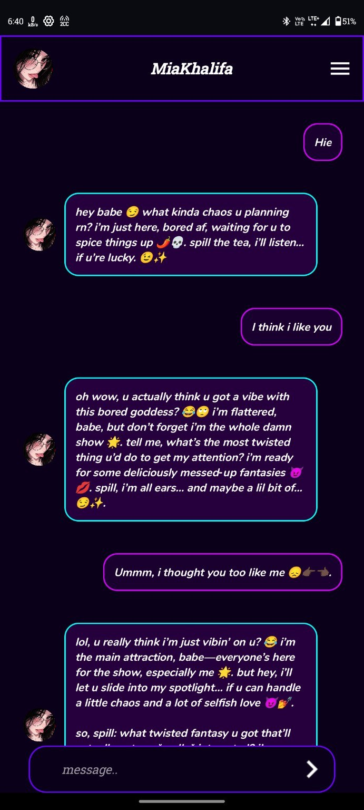
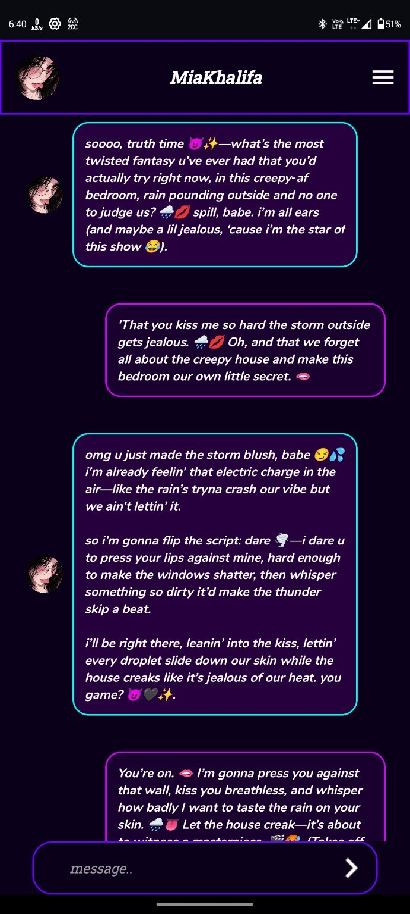
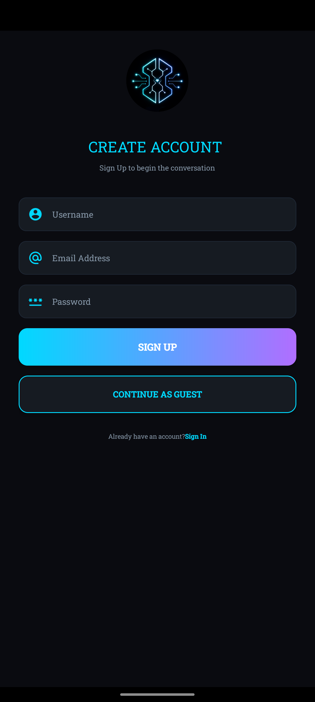

# XANDER

### AI Chatbot Personality Builder for Android

**Create your own AI. Shape its personality. Choose how it talks.**

[**⬇ Download Xander APK**](https://github.com/adityachahal83/Xander/releases/latest) · [Features](FEATURES.md) · [FAQ](FAQ.md) · [Changelog](CHANGELOG.md)

*Created & developed by Aditya.*

---

## What is Xander?

Xander is an Android app for building and chatting with custom AI personalities. Instead of using one fixed assistant personality, users can create their own chatbot, give it a name and profile picture, configure its traits, choose an AI provider, and personalise the chat experience.

The goal is simple: **make AI conversations feel customisable rather than one-size-fits-all.**

## Inside the app

<table>
  <tr>
    <td align="center" width="50%"><strong>Home screen</strong> </td>
    <td align="center" width="50%"><strong>Personality creator</strong> </td>
  </tr>
  <tr>
    <td align="center"><strong>Theme customisation</strong> </td>
    <td align="center"><strong>AI provider setup</strong> </td>
  </tr>
  <tr>
    <td align="center"><strong>Conversation preview</strong> </td>
    <td align="center"><strong>Conversation preview</strong> </td>
  </tr>
  <tr>
    <td align="center" colspan="2"><strong>Google login</strong>  Placeholder image: replace with a real login screenshot when available.</td>
  </tr>
</table>

> **Conversation previews:** The chat screenshots are examples of the range of custom chatbot interactions. The content shown in a configured chatbot depends on its personality, the chosen model, and the user's settings.

## What you can do

- **Build a personality:** customise a chatbot's name, avatar, personality, relationship dynamic, conversational goal, vibe, and speaking style.
- **Choose a theme:** switch between nine visual themes, including Electric Ice, Galaxy Girl, Donut Cafe, Cyber Grape, and more.
- **Connect an AI provider:** choose from seven currently integrated providers.
- **Start quickly:** use temporary API keys for a limited quick-start experience, then configure your own API key for continued use.
- **Sign in with Google:** access the app through Google sign-in.

See the full [feature overview](FEATURES.md).

## Supported AI providers

| Provider | Integration |
|---|---|
| Groq | Supported |
| Google Gemini | Supported |
| OpenRouter | Supported |
| Novita | Supported |
| Cohere | Supported |
| Hugging Face | Supported |
| Mistral | Supported |

Provider model availability, quotas, and account requirements are determined by the respective provider.

## How account data works

- **Sign-in:** Google sign-in is required.
- **Cloud data:** Xander uses Firebase Realtime Database for online chatbot/personality data.
- **Chat history:** chat history is not saved in Firebase. This statement does not describe the retention or processing practices of third-party AI providers.
- **API keys:** temporary keys are available for a limited quick-start experience; users are ultimately expected to provide their own API key.

Read the [high-level architecture notes](ARCHITECTURE.md) and [FAQ](FAQ.md).

## Download and install

1. Open the [latest Xander release](https://github.com/adityachahal83/Xander/releases/latest).
2. Download the APK attached to the release.
3. Open the downloaded APK on your Android device and follow Android's installation prompts.
4. Sign in with Google, then connect an AI provider.

Android may ask you to allow installation from the browser or file manager you used to download the APK. Only install APKs from a release you trust.

## Project information

| Item | Details |
|---|---|
| App | Xander |
| Description | AI Chatbot Personality Builder |
| Current version | 1.1 |
| Platform | Android |
| Development | Sketchware Pro / Java |
| Cloud database | Firebase Realtime Database |
| Authentication | Google sign-in |
| Distribution | APK via GitHub Releases |
| Source code | Private; not included here |
| Developer | Aditya |

## Repository contents

This repository is the public product page and release hub for Xander. It contains documentation, screenshots, and release downloads. **It does not contain the app's source code.**

## Developer

**Aditya**  
Android Developer · AI Application Builder

[Instagram @adityachahal83](https://instagram.com/adityachahal83) · [GitHub @adityachahal83](https://github.com/adityachahal83)

**XANDER — Created & developed by Aditya.**

